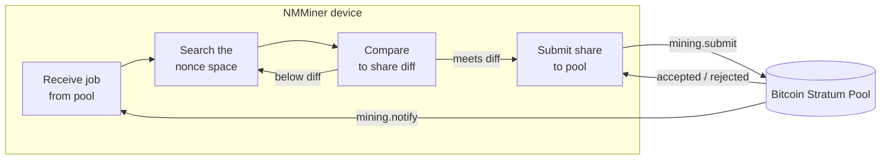

# NMMiner in der Pipeline

Eine Black-Box-Ansicht dessen, was auf dem Gerät zwischen „WiFi verbunden" und „Share akzeptiert" passiert.

## End-to-End-Bild

## Was Sie als Betreiber steuern können

| Drehknopf                         | Wirkung                                                          |
| ---------------------------- | --------------------------------------------------------------- |
| **Pool-URL**                 | Woher Jobs kommen und wohin Shares gehen.                       |
| **Wallet**                   | Wo die Pool-Auszahlungen landen.                                |
| **UI-Aktualisierungsrate**   | Höhere Rate → flüssigerer Bildschirm, aber etwas geringere Hashrate. Niedrigere Rate → maximale Hashrate. |
| **Bildschirmschoner-Modus**  | `Black` entfernt die Display-Neuzeichnungskosten → Spitzenhashrate. |
| **LED aktivieren**           | Nur kosmetisch.                                                  |
| **WiFi-Qualität**            | Ein instabiler AP verursacht Fehler beim Share-Senden; die Ablehnungen steigen. |

## Was NMMiner während der Arbeit anzeigt

- **Lade-Seite** — Boot, WiFi-Handshake, Ankunft des ersten Jobs.
- **Miner-Seite** — Live-Hashrate, Share-Zähler, Pool-Diff, Pool-URL, Betriebszeit.
- **Uhr-/Preis-/Wetter-Seiten** — schreibgeschützte Infoseiten, beeinflussen das Mining nicht.
- **Swarm-fähige Fußzeile** (auf der Miner-Seite) — wenn die [Swarm](../user-guide/swarm.md)-Funktion aktiv ist, verfolgt der Miner auch die LAN-weite Gesamthashrate.

## Was NMMiner **nicht** preisgibt

NMMiner ist Closed-Source-Firmware. Dieses Wiki dokumentiert die **Eingaben**, die **Ausgaben** und das **beobachtbare Verhalten** des Geräts. Es dokumentiert nicht:

- Wie die innere SHA-256d-Schleife implementiert ist (dies ist die Kern-Optimierungsarbeit von NMMiner).
- Das On-Chip-Task-Layout, Speicher-Layout oder den Treiber-Stack.
- Internes Speicher-Layout, Protokollpuffer oder die Stratum-Parser-Strategie.

Wenn Sie sich mit dem Gerät integrieren möchten, tun Sie dies über die dokumentierte [HTTP-API](../api/overview.md) — das ist der stabile, unterstützte Vertrag.
