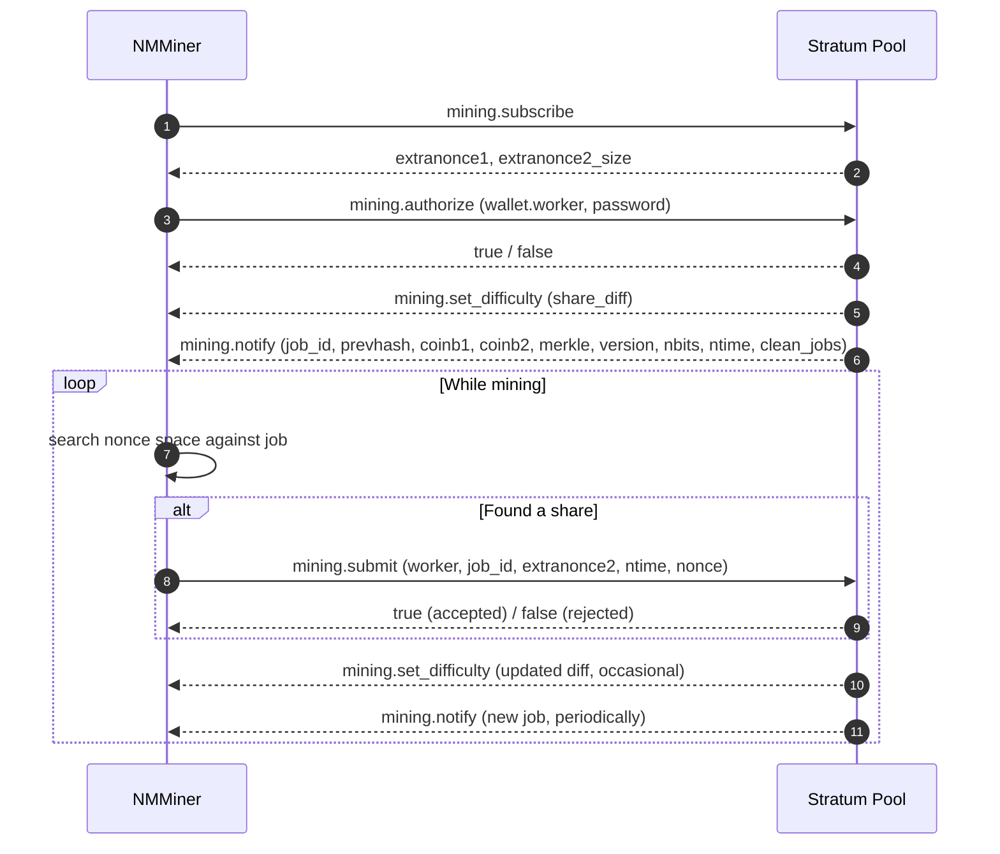

# Stratum-Protokoll

**Stratum v1** ist das De-facto-Protokoll, das Bitcoin-Mining-Pools verwenden, um mit Minern zu sprechen. NMMiner ist ein Stratum-v1-Client.

> Diese Seite dokumentiert nur die **öffentlichen, allgemein bekannten** Stratum-Nachrichten, die jeder Pool versteht. Pool-spezifische Erweiterungen und interne Implementierungsdetails sind außerhalb des Rahmens.

## Verbindung

- **Transport**: TCP, oder TLS-verpacktes TCP für SSL-Pools.
- **Adressschema**:
  - `stratum+tcp://host:port` — einfaches TCP.
  - `stratum+ssl://host:port` — TLS.
- **Worker-Identität**: die Wallet-Adresse, optional gefolgt von `.workerName`, z. B. `bc1q....workerName`.

Der Miner hält den Socket für die gesamte Sitzung offen. Wenn der Pool ihn schließt, verbindet NMMiner sich automatisch neu.

## Nachrichtenfluss

## Was jede Nachricht für Sie bedeutet

| Nachricht                   | Einfache Bedeutung                                                       |
| ------------------------- | ------------------------------------------------------------------- |
| `mining.subscribe`        | „Hallo, ich möchte Arbeit."                                                  |
| `mining.authorize`        | „Ich bin diese Wallet."                                                 |
| `mining.set_difficulty`   | Der Pool legt fest, wie leicht / schwer eine Share sein muss. Die NMMiner-Diff ist **winzig**. |
| `mining.notify`           | „Hier ist eine neue Blockvorlage zum Bearbeiten." Alte Jobs sind veraltet.   |
| `mining.submit`           | „Hier ist ein Hash, der die Diff erfüllt."                               |

Das ist alles, was es von der Miner-Seite her zum Protokoll gibt.

## Was NMMiner auf dem Bildschirm / in NM Monitor anzeigt

| Feld            | Stammt aus                                              |
| ---------------- | ------------------------------------------------------- |
| **Pool**         | Die konfigurierte URL (Host und Port).                     |
| **Diff**         | Neuestes `mining.set_difficulty`.                         |
| **Accepted**     | Anzahl der `true`-Antworten auf `mining.submit`.             |
| **Rejected**     | Anzahl der `false`-Antworten auf `mining.submit`.            |
| **Session Best** | Die Share mit der höchsten Schwierigkeit, die diesen Boot erzeugt wurde.        |
| **Ever Best**    | Die Share mit der höchsten Schwierigkeit, die über alle Boots erzeugt wurde. |
| **Hashrate**     | Interner gleitender Durchschnitt der Hashes pro Sekunde.           |

Siehe auch: [Pool-Liste](../reference/pool-list.md) für bekannte kompatible Endpunkte.
