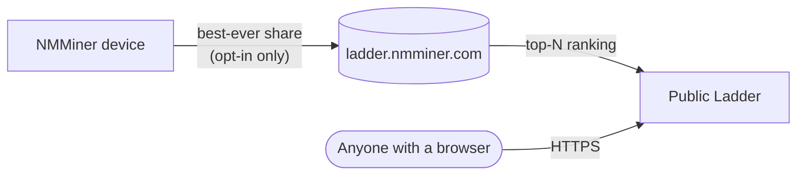

# Ladder — Globale Bestenliste

Die **Ladder** ist NMMiners globale Bestenliste. Sie sortiert teilnehmende Miner nach der **höchsten Share-Schwierigkeit, die sie je erzeugt haben** — Ihr Allzeit-Bestes, nicht Ihre Hashrate, nicht Ihre Share-Anzahl. Ein einziger Glücksmoment kann einen 5-Dollar-ESP32 über ein Lager voller ASICs heben.

🌐 **Öffentliche Ladder**: [https://ladder.nmminer.com/](https://ladder.nmminer.com/)

---

## So funktioniert es

Jeder Miner, der sich **anmeldet** (Opt-in), meldet periodisch seine beste Share-Schwierigkeit aller Zeiten an das Ladder-Backend. Das Backend aggregiert die Einträge und stellt die Spitzenreiter unter [ladder.nmminer.com](https://ladder.nmminer.com/) bereit.

## Ladder-Seite auf dem Gerät

Jeder NMMiner mit einem Display hat eine optionale **Ladder**-Seite, die die Bestenliste spiegelt — sehen Sie die globalen Top-10 direkt auf Ihrem Miner. Aktivieren Sie sie zusammen mit dem Opt-in unten.

:::tip Bildschirmlose Boards (Varianten ohne OLED / ohne Display)
Boards ohne Display können trotzdem an der Ladder teilnehmen. Öffnen Sie einfach [NM Monitor](./nm-monitor.md) → **Preferences** und schalten Sie den **Ladder**-Schalter ein. Ihr Miner meldet normal, auch wenn es keine On-Device-Seite zum Ansehen gibt.
:::

## Opt-in (standardmäßig aus)

Die Ladder ist **Opt-in**. Ab Werk meldet NMMiner nichts. Zum Beitreten:

1. Öffnen Sie [NM Monitor](./nm-monitor.md) → **Preferences**.
2. Schalten Sie **Ladder** ein.
3. Speichern Sie. Die On-Device-Ladder-Seite wird aktiv (auf Boards mit Bildschirm) und Ihr Miner beginnt zu melden.

Sie können die Einstellung auch über die HTTP-API ändern — siehe [`POST /api/setting/preference`](../api/settings-preference.md) (`LadderEnable: true`).

## Datenschutz

NMMiner nimmt den Datenschutz der Teilnehmer ernst:

- **Keine persönlichen Daten** — nur die Wallet-Adresse, auf die Sie minen, wird gemeldet, und nur die **ersten 4 + letzten 4 Zeichen** dieser Adresse werden je öffentlich angezeigt (`bc1q…ab12`).
- **Keine IP, kein Hostname** — nichts, das Sie oder Ihr Netzwerk identifizieren könnte.
- **Standardmäßig aus** — Sie müssen die Funktion bewusst aktivieren.

## Warum teilnehmen?

- 🏅 **Angeberrechte** — sehen Sie, wie glücklich Ihr winziger ESP32 im Vergleich zur Welt war.
- 🤝 **Community** — die Ladder ist das De-facto-Treffen für ESP32-BTC-Enthusiasten.
- ✨ **Der Nervenkitzel** — eine Share mit hoher Schwierigkeit zu treffen ist selten; die Ladder ist der Ort, an dem diese Momente gefeiert werden.

---

> Besuchen Sie [https://ladder.nmminer.com/](https://ladder.nmminer.com/), um den aktuellen Stand zu sehen.
