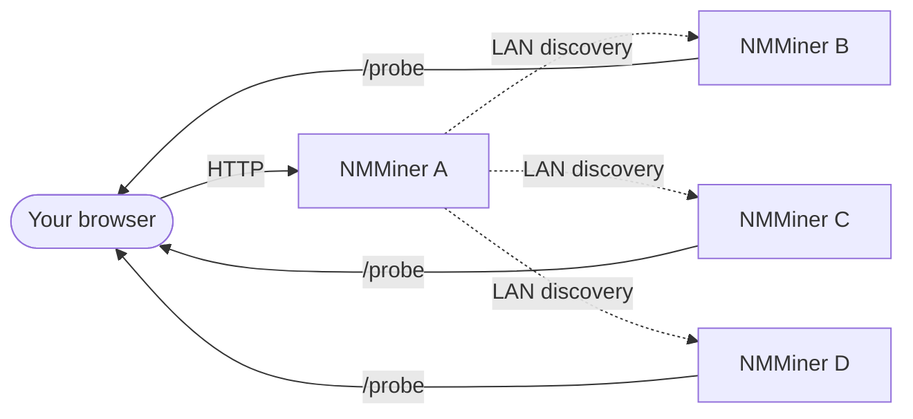

# Swarm-Menü

Das **Swarm**-Menü in [NM Monitor](./nm-monitor.md) lässt Sie **jeden NMMiner im selben LAN** von einer einzigen Browserseite aus sehen und verwalten — mit **null Installation**.

Ein einzelnes /24-Subnetz kann bis zu **255 Geräte** beherbergen, die über Swarm auffindbar sind — problemlos genug für ein ernsthaftes Heim-/Lab-Deployment.

## So funktioniert es (Benutzeransicht)

1. Sie öffnen NM Monitor auf **irgendeinem** Miner (oder einem beliebigen Gerät, das das LAN erreichen kann).
2. Das Swarm-Menü führt einen schnellen LAN-Sweep durch.
3. Jeder erreichbare NMMiner erscheint als Zeile.
4. NM Monitor summiert deren Hashraten, listet ihre Pools und lässt Sie jeden anpingen.

Der Browser übernimmt die Aggregation — kein zentraler Server, keine Cloud, kein Konto.

## Was die Swarm-Tabelle zeigt

| Spalte          | Bedeutung                                                                |
| --------------- | ---------------------------------------------------------------------- |
| **Hostname**    | Der Hostname des Miners (den Sie auf der Network-Seite festlegen).               |
| **IP**          | Die LAN-IP des Miners.                                                    |
| **Version**     | Vom Miner gemeldete Firmware-Version.                                |
| **Hashrate**    | Aktuelle Hashrate in H/s.                                               |
| **Session Best**| Beste Share-Schwierigkeit seit dem letzten Boot des Miners.                     |
| **Ever Best**   | Beste Share-Schwierigkeit über alle Sitzungen.                             |
| **Uptime**      | Sekunden seit dem Boot.                                                    |
| **Find**        | Eine Schaltfläche, die Bildschirm + LED des Miners aufblitzen lässt, damit Sie ihn physisch lokalisieren können. |

Eine Fußzeile summiert die Hashrate des gesamten Schwarms, sodass Sie Ihre gesamte LAN-Hashrate auf einen Blick sehen. Während ein Scan läuft, zeigt NM Monitor auch eine **Fortschrittsleiste** (hinzugefügt in v2.0.03).

## Häufige Aufgaben

### Einen bestimmten Miner physisch finden

1. Öffnen Sie Swarm.
2. Klicken Sie auf die **Find**-Schaltfläche der Zielzeile.
3. Der ausgewählte Miner lässt Bildschirm und LED einige Sekunden lang aufblitzen — gehen Sie hin und holen Sie ihn.

Das ist nur ein einzelner HTTP-Aufruf ([`POST /api/swarm/find`](../api/swarm-find.md)) — Sie können ihn auch aus Ihren eigenen Skripten auslösen.

### Miner auf einen Blick vergleichen

Sortieren Sie die Tabelle nach **Hashrate**, **Session Best** oder **Uptime**, um zu sehen, welches Board am besten läuft.

### LAN erneut scannen

Das Swarm-Menü aktualisiert sich von selbst, wenn Sie es öffnen. Um einen sofortigen erneuten Scan zu erzwingen, verlassen Sie das Menü und kehren zurück, oder laden Sie die Seite neu.

:::tip
Möchten Sie Ihr eigenes Dashboard bauen? Jede Spalte der Swarm-Tabelle bildet sich direkt auf einen öffentlichen HTTP-Endpunkt ab. Siehe [API-Referenz › Discovery](../api/discovery.md).
:::
