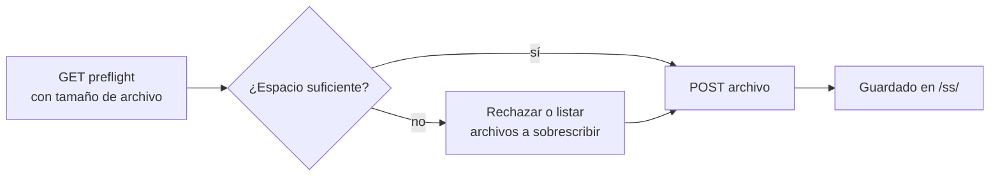

# Carga de protector de pantalla

Suba una imagen de protector de pantalla personalizada. El navegador convierte primero un PNG / JPG / imagen al formato `.ss` del dispositivo; esta API recibe ese archivo ya convertido.

> La mayoría de los usuarios deberían usar la página **Screensaver** en [NM Monitor](../user-guide/nm-monitor.md) — realiza la conversión automáticamente. Esta página es para integradores que desean enviar sus propios recursos mediante programación.

---

## Flujo de dos pasos



---

## `GET /api/update/screensaver/preflight`

Pregunta al dispositivo si un archivo de `size` bytes puede almacenarse. El dispositivo decide si primero debe liberar espacio (sobrescribiendo el protector de pantalla más antiguo).

### Parámetros de consulta

| Nombre   | Requerido | Significado                                               |
| ------ | -------- | ----------------------------------------------------- |
| `size` | sí      | Tamaño en bytes del archivo `.ss` que pretende subir. |

### Respuesta — el archivo cabe

```json
{
  "fileSize":       65536,
  "fsFree":         262144,
  "maxUploadable":  327680,
  "action":         "new",
  "overwriteCount": 0,
  "overwriteFiles": [],
  "existingCount":  2,
  "spaceAfter":     196608
}
```

### Respuesta — necesita sobrescribir

```json
{
  "fileSize":       180000,
  "fsFree":         60000,
  "maxUploadable":  400000,
  "action":         "overwrite",
  "overwriteCount": 2,
  "overwriteFiles": [
    {"name": "saver_320_240_001.ss", "size": 65536},
    {"name": "saver_320_240_002.ss", "size": 72104}
  ],
  "existingCount":  4,
  "spaceAfter":     17640
}
```

### Respuesta — demasiado grande

```json
{
  "fileSize":       1500000,
  "fsFree":         60000,
  "maxUploadable":  400000,
  "action":         "reject",
  "overwriteCount": 0,
  "overwriteFiles": [],
  "existingCount":  4,
  "spaceAfter":     0
}
```

| Campo              | Tipo      | Significado                                                        |
| ------------------ | --------- | -------------------------------------------------------------- |
| `fileSize`         | integer   | Eco del tamaño de carga solicitado.                             |
| `fsFree`           | integer   | Bytes libres actuales en el FS del dispositivo.                        |
| `maxUploadable`    | integer   | Bytes libres **más** todos los bytes de protectores existentes — el límite superior absoluto. |
| `action`           | string    | `"new"`, `"overwrite"` o `"reject"`.                         |
| `overwriteCount`   | integer   | Cuántos protectores existentes se eliminarán para hacer espacio.    |
| `overwriteFiles`   | object[]  | La lista de archivos a punto de eliminarse (`name` + `size`).        |
| `existingCount`    | integer   | Archivos de protector existentes que coinciden con el tamaño de pantalla actual.    |
| `spaceAfter`       | integer   | Bytes libres previstos una vez que la carga aterrice.                     |

---

## `POST /api/update/screensaver`

Sube el archivo `.ss` real como `multipart/form-data`.

### Solicitud

- Tipo de contenido: `multipart/form-data`
- Extensión de archivo: **debe terminar en `.ss`**.
- Tamaño máximo: **200 KB**.
- Primeros 2 bytes del archivo: magic `0x4E 0x53`.

### Respuesta — éxito

```json
{
  "status": "ok",
  "path":   "/ss/saver_320_240_003.ss"
}
```

### Respuesta — fallo

| Estado | Cuerpo                              | Causa                                 |
| ------ | --------------------------------- | ------------------------------------- |
| 400    | `Only .ss files are accepted.`    | Extensión de archivo incorrecta.                 |
| 400    | `Invalid .ss file header.`        | Los bytes magic no coinciden.             |
| 413    | `File too large (max 200 KB).`    | El cuerpo excedió 200 KB.                 |
| 500    | `Failed to open file for writing.`| Error del sistema de archivos.                    |
| 500    | `Write error.`                    | Error del sistema de archivos durante la escritura.       |

### Ejemplo

```bash
SIZE=$(stat -c%s saver_320_240_003.ss)
curl "http://192.168.1.42/api/update/screensaver/preflight?size=$SIZE"
# inspeccione "action"; si es "reject", aborte
curl -X POST -F "file=@saver_320_240_003.ss" \
     http://192.168.1.42/api/update/screensaver
```

:::warning
Subir un protector de pantalla **pausa brevemente el minado** mientras el sistema de archivos se vacía. La tasa de hash vuelve a la normalidad en ~1 segundo.
:::
