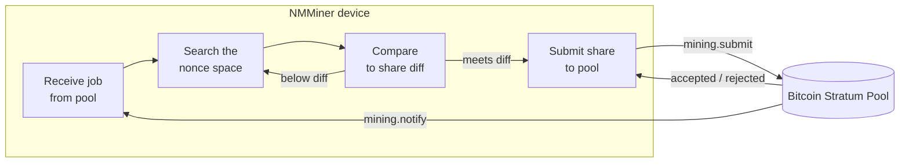

# NMMiner en el pipeline

Una vista de caja negra de lo que ocurre en el dispositivo entre "WiFi activo" y "share aceptada".

## Imagen de extremo a extremo

## Lo que usted, el operador, controla

| Perilla                         | Efecto                                                          |
| ---------------------------- | --------------------------------------------------------------- |
| **URL del pool**                 | De dónde vienen los trabajos y a dónde van las shares.                       |
| **Billetera**                   | Dónde caen los pagos del pool.                                        |
| **Tasa de refresco de UI**          | Mayor tasa → pantalla más suave pero tasa de hash ligeramente menor. Menor tasa → máxima tasa de hash. |
| **Modo de protector de pantalla**        | `Black` elimina el costo de redibujado de pantalla → tasa de hash pico.            |
| **Habilitar LED**               | Solo cosmético.                                                  |
| **Calidad de WiFi**             | Un AP inestable causa fallos al enviar shares; los rechazos aumentan.          |

## Lo que NMMiner le muestra mientras trabaja

- **Página Loading** — arranque, handshake WiFi, llegada del primer trabajo.
- **Página Miner** — tasa de hash en vivo, contadores de shares, diff del pool, URL del pool, tiempo de actividad.
- **Páginas Clock / Price / Weather** — páginas de información de solo lectura, no afectan el minado.
- **Pie de página con Swarm** (en la página Miner) — cuando la función [Swarm](../user-guide/swarm.md) está activa, el minero también rastrea la tasa de hash total de la LAN.

## Lo que NMMiner **no** expone

NMMiner es firmware de código cerrado. Esta wiki documenta las **entradas**, las **salidas** y el **comportamiento observable** del dispositivo. No documenta:

- Cómo se implementa el bucle interno SHA-256d (este es el trabajo central de optimización de NMMiner).
- El diseño de tareas en chip, el diseño de memoria o la pila de controladores.
- El diseño de almacenamiento interno, los buffers de protocolo o la estrategia del analizador Stratum.

Si desea integrarse con el dispositivo, hágalo a través de la [HTTP API](../api/overview.md) documentada — ese es el contrato estable y soportado.
