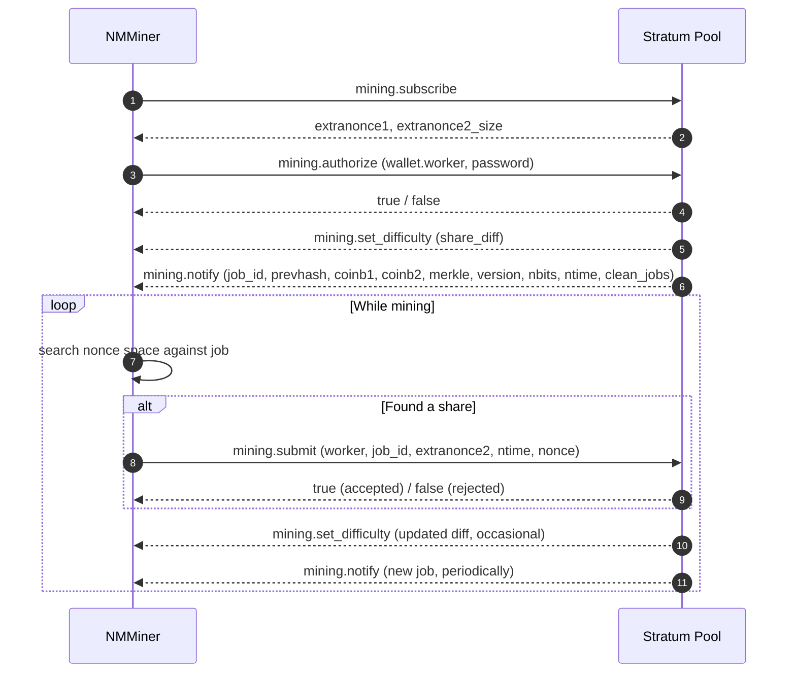

# Protocolo Stratum

**Stratum v1** es el protocolo de facto que los pools de minería de Bitcoin usan para comunicarse con los mineros. NMMiner es un cliente Stratum v1.

> Esta página solo documenta los mensajes Stratum **públicos y bien conocidos** que todo pool entiende. Las extensiones específicas del pool y los detalles de implementación interna están fuera del alcance.

## Conexión

- **Transporte**: TCP, o TCP envuelto en TLS para pools SSL.
- **Esquema de dirección**:
  - `stratum+tcp://host:port` — TCP simple.
  - `stratum+ssl://host:port` — TLS.
- **Identidad del trabajador**: la dirección de billetera seguida opcionalmente de `.nombreDeTrabajador`, p. ej. `bc1q....nombreDeTrabajador`.

El minero mantiene el socket abierto durante toda la sesión. Si el pool lo cierra, NMMiner se reconecta automáticamente.

## Flujo de mensajes

## Qué significa cada mensaje para usted

| Mensaje                   | Significado simple                                                       |
| ------------------------- | ------------------------------------------------------------------- |
| `mining.subscribe`        | "Hola, quiero trabajo."                                                  |
| `mining.authorize`        | "Soy esta billetera."                                                 |
| `mining.set_difficulty`   | El pool establece qué tan fácil / difícil debe ser una share. La diff de NMMiner es **diminuta**. |
| `mining.notify`           | "Aquí hay una nueva plantilla de bloque en la que trabajar." Los trabajos antiguos quedan obsoletos.   |
| `mining.submit`           | "Aquí hay un hash que cumple la diff."                               |

Eso es todo lo que hay del protocolo desde el lado del minero.

## Lo que NMMiner le muestra en pantalla / en NM Monitor

| Campo            | Proviene de                                              |
| ---------------- | ------------------------------------------------------- |
| **Pool**         | La URL configurada (host y puerto).                     |
| **Diff**         | Último `mining.set_difficulty`.                         |
| **Accepted**     | Conteo de respuestas `true` a `mining.submit`.             |
| **Rejected**     | Conteo de respuestas `false` a `mining.submit`.            |
| **Session Best** | La share de mayor dificultad producida en este arranque.        |
| **Ever Best**    | La share de mayor dificultad producida en todos los arranques. |
| **Hashrate**     | Promedio móvil interno de hashes por segundo.           |

Véase también: [Lista de pools](../reference/pool-list.md) para endpoints compatibles conocidos.
