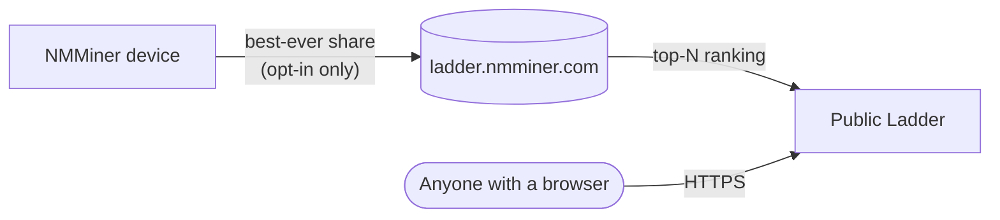

# Ladder — Tabla de clasificación global

El **Ladder** es la tabla de clasificación global de NMMiner. Clasifica a los mineros participantes por la **mayor dificultad de share que jamás hayan producido** — su mejor histórico, no su tasa de hash, no su conteo de shares. Un solo momento de suerte puede poner un ESP32 de $5 por encima de un almacén de ASIC.

🌐 **Ladder público**: [https://ladder.nmminer.com/](https://ladder.nmminer.com/)

---

## Cómo funciona

Cada minero que **se registra** (opt-in) informa periódicamente su mejor dificultad de share de todos los tiempos al backend de Ladder. El backend agrega las entradas y expone a los mejores en [ladder.nmminer.com](https://ladder.nmminer.com/).

## Página Ladder en el dispositivo

Cada NMMiner con pantalla tiene una página **Ladder** opcional que refleja la tabla de clasificación — vea el top-10 global directamente en su minero. Actívela junto con el opt-in de abajo.

:::tip Placas sin pantalla (variantes sin OLED / sin pantalla)
Las placas sin pantalla aún pueden unirse a la Ladder. Simplemente abra [NM Monitor](./nm-monitor.md) → **Preferences** y active el interruptor **Ladder**. Su minero informará normalmente, aunque no haya una página en el dispositivo para ver.
:::

## Opt-in (está desactivado por defecto)

La Ladder es **opt-in**. De fábrica NMMiner no informa nada. Para unirse:

1. Abra [NM Monitor](./nm-monitor.md) → **Preferences**.
2. Active **Ladder**.
3. Guarde. La página Ladder del dispositivo se activa (en placas con pantalla) y su minero comienza a informar.

También puede cambiar la configuración a través de la HTTP API — véase [`POST /api/setting/preference`](../api/settings-preference.md) (`LadderEnable: true`).

## Privacidad

NMMiner se toma en serio la privacidad de los participantes:

- **Sin información personal** — solo se informa la dirección de billetera a la que mina, y solo se muestran públicamente los **primeros 4 + últimos 4 caracteres** de esa dirección (`bc1q…ab12`).
- **Sin IP, sin hostname** — nada que pueda identificarlo a usted o a su red.
- **Desactivado por defecto** — debe habilitar la función conscientemente.

## ¿Por qué unirse?

- 🏅 **Derecho a presumir** — vea qué tan afortunado ha sido su pequeño ESP32 en comparación con el mundo.
- 🤝 **Comunidad** — la Ladder es el punto de encuentro de facto para entusiastas de BTC en ESP32.
- ✨ **La emoción** — lograr una share de alta dificultad es raro; la Ladder es donde se celebran esos momentos.

---

> Visite [https://ladder.nmminer.com/](https://ladder.nmminer.com/) para ver la clasificación actual.
