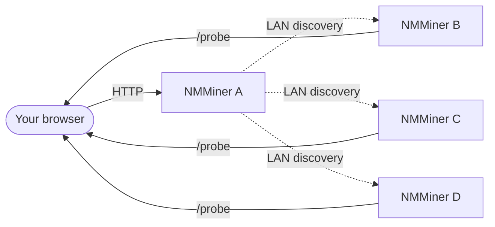

# Menú Swarm

El menú **Swarm** en [NM Monitor](./nm-monitor.md) le permite ver y gestionar **cada NMMiner en la misma LAN** desde una sola página de navegador, con **cero instalación**.

Una sola subred /24 puede alojar hasta **255 dispositivos** descubribles a través de Swarm — suficiente para un despliegue serio en casa / laboratorio.

## Cómo funciona (vista de usuario)

1. Abra NM Monitor en **cualquier** minero (o cualquier dispositivo que pueda alcanzar la LAN).
2. El menú Swarm realiza un barrido rápido de la LAN.
3. Cada NMMiner accesible aparece como una fila.
4. NM Monitor suma sus tasas de hash, lista sus pools y le permite hacer ping a cada uno.

El navegador hace la agregación — sin servidor central, sin nube, sin cuenta.

## Qué muestra la tabla Swarm

| Columna          | Significado                                                                |
| --------------- | ---------------------------------------------------------------------- |
| **Hostname**    | El hostname del minero (lo configura en la página Network).               |
| **IP**          | La IP LAN del minero.                                                    |
| **Version**     | Versión de firmware informada por el minero.                                |
| **Hashrate**    | Tasa de hash actual en H/s.                                               |
| **Session Best**| Mejor dificultad de share desde el último arranque del minero.                     |
| **Ever Best**   | Mejor dificultad de share en todas las sesiones.                             |
| **Uptime**      | Segundos desde el arranque.                                                    |
| **Find**        | Un botón que hace parpadear la pantalla + LED del minero para que pueda localizarlo físicamente. |

Una fila de pie suma la tasa de hash de todo el enjambre para que vea su tasa de hash total de LAN de un vistazo. Mientras un escaneo está en curso, NM Monitor también muestra una **barra de progreso** (añadida en v2.0.03).

## Tareas comunes

### Encontrar un minero específico físicamente

1. Abra Swarm.
2. Haga clic en el botón **Find** de la fila objetivo.
3. El minero seleccionado parpadea su pantalla y LED durante unos segundos — acérquese y tómelo.

Esto es solo una llamada HTTP ([`POST /api/swarm/find`](../api/swarm-find.md)) — también puede dispararla desde sus propios scripts.

### Comparar mineros de un vistazo

Ordene la tabla por **Hashrate**, **Session Best** o **Uptime** para ver qué placa rinde mejor.

### Re-escanear la LAN

El menú Swarm se actualiza solo al abrirlo. Para forzar un reescaneo inmediato, salga del menú y vuelva, o recargue la página.

:::tip
¿Quiere construir su propio panel? Cada columna de la tabla Swarm se asigna directamente a un endpoint HTTP público. Véase [API Reference › Discovery](../api/discovery.md).
:::
