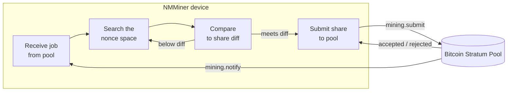

# パイプラインの中の NMMiner

「WiFi 接続」から「シェア承認」までの間、デバイス上で何が起きているかをブラックボックス視点で説明します。

## エンドツーエンドの図

## オペレーターとして制御できるもの

| ツマミ                         | 効果                                                          |
| ---------------------------- | --------------------------------------------------------------- |
| **プール URL**                 | ジョブの出所とシェアの行き先。                       |
| **ウォレット**                   | プール支払いの送付先。                                        |
| **UI リフレッシュレート**          | 高いレート → 画面は滑らかだがハッシュレートはやや低下。低いレート → 最大ハッシュレート。 |
| **スクリーンセーバーモード**        | `Black` は画面再描画コストを除去 → ピークハッシュレート。            |
| **LED 有効化**               | 見た目のみ。                                                  |
| **WiFi 品質**             | 不安定な AP はシェア送信失敗を引き起こし、拒否が増えます。          |

## 動作中に NMMiner が表示するもの

- **Loading ページ** — 起動、WiFi ハンドシェイク、最初のジョブ到着。
- **Miner ページ** — ライブハッシュレート、シェアカウンタ、プール diff、プール URL、稼働時間。
- **Clock / Price / Weather ページ** — 読み取り専用の情報ページで、マイニングには影響しません。
- **Swarm 対応フッター**（Miner ページ）— [Swarm](../user-guide/swarm.md) 機能が有効な場合、マイナーは LAN 全体の合計ハッシュレートも追跡します。

## NMMiner が **公開しない** もの

NMMiner はクローズドソースのファームウェアです。この Wiki はデバイスの **入力**、**出力**、**観測可能な動作** を文書化します。以下は文書化しません：

- SHA-256d 内部ループの実装方法（これは NMMiner のコア最適化作業です）。
- オンチップのタスクレイアウト、メモリレイアウト、ドライバスタック。
- 内部ストレージレイアウト、プロトコルバッファ、Stratum パーサー戦略。

デバイスと統合したい場合は、文書化された [HTTP API](../api/overview.md) を通じて行ってください — それが安定したサポート対象の契約です。
