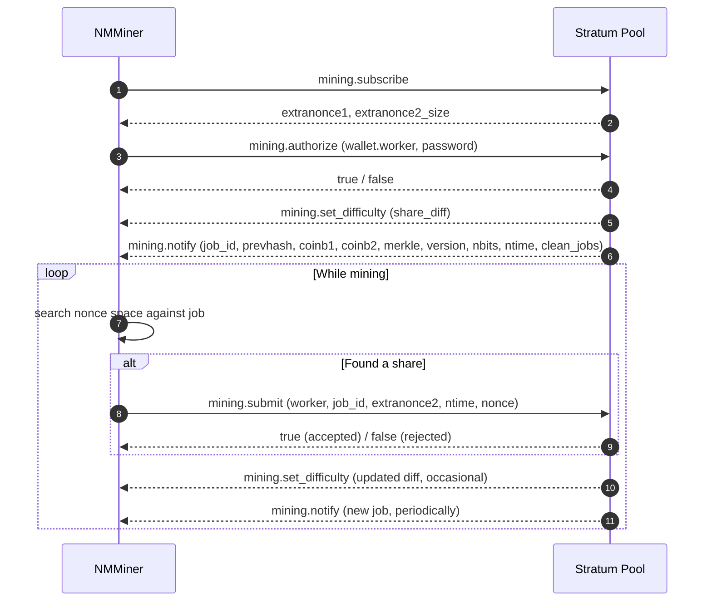

# Stratum プロトコル

**Stratum v1** は、Bitcoin マイニングプールがマイナーと通信するために使用する事実上のプロトコルです。NMMiner は Stratum v1 クライアントです。

> このページは、すべてのプールが理解する **公開されたよく知られた** Stratum メッセージのみを文書化します。プール固有の拡張や内部実装の詳細は対象外です。

## 接続

- **トランスポート**: TCP、または SSL プールの場合は TLS ラップされた TCP。
- **アドレススキーム**:
  - `stratum+tcp://host:port` — プレーン TCP。
  - `stratum+ssl://host:port` — TLS。
- **ワーカー ID**: ウォレットアドレスにオプションで `.workerName` を付加。例：`bc1q....workerName`。

マイナーはセッション全体を通じてソケットを開いたままにします。プールが切断した場合、NMMiner は自動的に再接続します。

## メッセージフロー

## 各メッセージの意味

| メッセージ                   | 平易な意味                                                       |
| ------------------------- | ------------------------------------------------------------------- |
| `mining.subscribe`        | 「こんにちは、仕事が欲しいです。」                                                  |
| `mining.authorize`        | 「私はこのウォレットです。」                                                 |
| `mining.set_difficulty`   | プールがシェアの難易度を設定します。NMMiner の diff は **ごくわずか** です。 |
| `mining.notify`           | 「ここに作業対象の新しいブロックテンプレートがあります。」古いジョブは廃棄されます。   |
| `mining.submit`           | 「ここに diff を満たすハッシュがあります。」                               |

マイナー側のプロトコルはこれだけです。

## 画面 / NM Monitor で NMMiner が表示するもの

| フィールド            | 由来                                              |
| ---------------- | ------------------------------------------------------- |
| **Pool**         | 設定された URL（ホストとポート）。                     |
| **Diff**         | 最新の `mining.set_difficulty`。                         |
| **Accepted**     | `mining.submit` への `true` 応答の数。             |
| **Rejected**     | `mining.submit` への `false` 応答の数。            |
| **Session Best** | この起動で生成された最高難易度のシェア。        |
| **Ever Best**    | 全起動を通じて生成された最高難易度のシェア。 |
| **Hashrate**     | 1 秒あたりのハッシュ数の内部移動平均。           |

関連項目: [プール一覧](../reference/pool-list.md) — 既知の互換エンドポイント。
