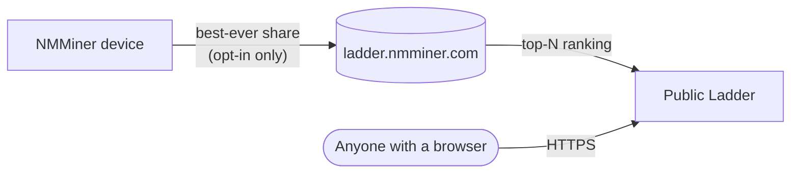

# ラダー — グローバルリーダーボード

**ラダー** は NMMiner のグローバルリーダーボードです。参加マイナーを **これまでに生成した最高シェア難易度** でランク付けします — ハッシュレートでもシェア数でもなく、過去最高のベストです。たった 1 回の幸運な瞬間が、$5 の ESP32 を ASIC の倉庫よりも上に押し上げることができます。

🌐 **公開ラダー**: [https://ladder.nmminer.com/](https://ladder.nmminer.com/)

---

## 仕組み

**オプトインした** 各マイナーは、過去最高のシェア難易度をラダーバックエンドに定期的に報告します。バックエンドはエントリを集約し、[ladder.nmminer.com](https://ladder.nmminer.com/) で上位者を公開します。

## デバイス上のラダーページ

ディスプレイ付きの各 NMMiner には、リーダーボードを反映するオプションの **Ladder** ページがあります — グローバル Top-10 をマイナー上で直接確認できます。下記のオプトインと一緒に有効化します。

:::tip 画面なしボード（OLED なし / ディスプレイなしバリアント）
ディスプレイのないボードもラダーに参加できます。[NM Monitor](./nm-monitor.md) → **Preferences** を開き、**Ladder** スイッチをオンにするだけです。表示するデバイスページがなくても、マイナーは正常に報告します。
:::

## オプトイン（デフォルトはオフ）

ラダーは **オプトイン** です。出荷時、NMMiner は何も報告しません。参加するには：

1. [NM Monitor](./nm-monitor.md) → **Preferences** を開きます。
2. **Ladder** をオンにします。
3. 保存します。デバイスのラダーページが有効になり（画面付きボード）、マイナーが報告を開始します。

HTTP API 経由でも設定を変更できます — [`POST /api/setting/preference`](../api/settings-preference.md)（`LadderEnable: true`）を参照してください。

## プライバシー

NMMiner は参加者のプライバシーを重視しています：

- **個人情報なし** — マイニング先のウォレットアドレスのみが報告され、公開されるのはそのアドレスの **先頭 4 文字 + 末尾 4 文字** のみです（`bc1q…ab12`）。
- **IP なし、ホスト名なし** — あなたやあなたのネットワークを特定できるものはありません。
- **デフォルトでオフ** — 機能を意識的に有効化する必要があります。

## 参加する理由

- 🏅 **自慢できる権利** — あなたの小さな ESP32 が世界と比べてどれだけ幸運だったかを確認できます。
- 🤝 **コミュニティ** — ラダーは ESP32 BTC 愛好家の事実上の集いの場です。
- ✨ **スリル** — 高難易度のシェアを出すことは稀です。ラダーはその瞬間が祝われる場所です。

---

> 現在の順位を見るには [https://ladder.nmminer.com/](https://ladder.nmminer.com/) にアクセスしてください。
