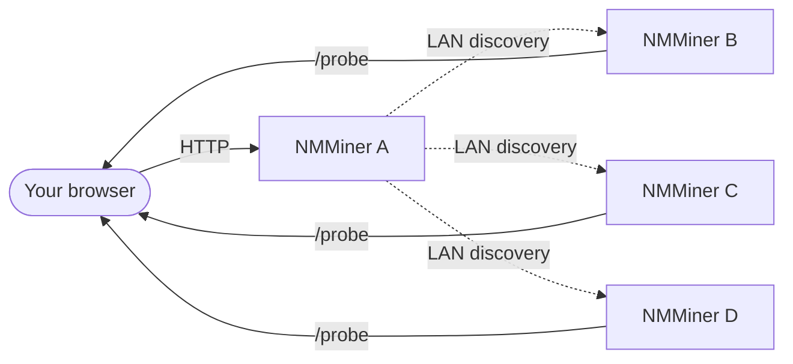

# Swarm メニュー

[NM Monitor](./nm-monitor.md) の **Swarm** メニューを使うと、**同じ LAN 上のすべての NMMiner** を単一のブラウザページから **ゼロインストール** で表示・管理できます。

単一の /24 サブネットは Swarm を通じて検出可能な最大 **255 デバイス** をホストできます — 本格的なホーム / ラボ展開には十分な数です。

## 仕組み（ユーザービュー）

1. **任意の 1 台** のマイナー（または LAN に到達可能な任意のデバイス）で NM Monitor を開きます。
2. Swarm メニューが高速な LAN スイープを実行します。
3. 到達可能なすべての NMMiner が行として表示されます。
4. NM Monitor はそれらのハッシュレートを合計し、プールを一覧表示し、各マイナーに Ping を送信できます。

ブラウザが集約を行います — 中央サーバーなし、クラウドなし、アカウントなし。

## Swarm テーブルの表示内容

| 列          | 意味                                                                |
| --------------- | ---------------------------------------------------------------------- |
| **Hostname**    | マイナーのホスト名（Network ページで設定します）。               |
| **IP**          | マイナーの LAN IP。                                                    |
| **Version**     | マイナーが報告するファームウェアバージョン。                                |
| **Hashrate**    | 現在のハッシュレート（H/s）。                                               |
| **Session Best**| 前回起動以降の最高シェア難易度。                     |
| **Ever Best**   | 全セッションを通じた最高シェア難易度。                             |
| **Uptime**      | 起動からの秒数。                                                    |
| **Find**        | マイナーの画面 + LED を点滅させて物理的に特定できるボタン。 |

フッター行は群れ全体のハッシュレートを合計し、LAN の合計ハッシュレートを一目で確認できます。スキャン実行中、NM Monitor は **プログレスバー** も表示します（v2.0.03 で追加）。

## 一般的なタスク

### 特定のマイナーを物理的に探す

1. Swarm を開きます。
2. 対象行の **Find** ボタンをクリックします。
3. 選択したマイナーが数秒間画面と LED を点滅させます — 歩いて行って手に取ってください。

これは単一の HTTP 呼び出しです（[`POST /api/swarm/find`](../api/swarm-find.md)）— 独自のスクリプトからもトリガーできます。

### マイナーを一目で比較

テーブルを **Hashrate**、**Session Best**、**Uptime** で並べ替えて、どのボードが最も良く機能しているかを確認します。

### LAN を再スキャン

Swarm メニューは開くと自動で更新されます。即時の再スキャンを強制するには、メニューを離れて戻るか、ページを再読み込みします。

:::tip
独自のダッシュボードを作りたいですか？Swarm テーブルの各列は公開 HTTP エンドポイントに直接対応しています。[API Reference › Discovery](../api/discovery.md) を参照してください。
:::
