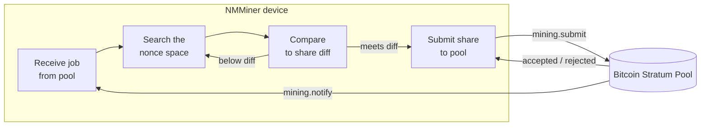

# NMMiner in the Pipeline

"WiFi 연결"부터 "셰어 수락"까지 기기에서 일어나는 일을 블랙박스 관점에서 설명합니다.

## 엔드투엔드 그림

## 운영자로서 제어할 수 있는 것

| 노브                         | 효과                                                          |
| ---------------------------- | --------------------------------------------------------------- |
| **풀 URL**                 | 작업의 출처와 셰어의 목적지.                       |
| **지갑**                   | 풀 지불금이 도착하는 곳.                                        |
| **UI 새로고침 속도**          | 높은 속도 → 화면은 부드럽지만 해시레이트는 약간 낮음. 낮은 속도 → 최대 해시레이트. |
| **화면 보호기 모드**        | `Black`은 화면 재그리기 비용을 제거 → 피크 해시레이트.            |
| **LED 활성화**               | 외관상 목적만.                                                  |
| **WiFi 품질**             | 불안정한 AP는 셰어 제출 실패를 유발하고 거부가 늘어납니다.          |

## 작동 중 NMMiner가 표시하는 것

- **Loading 페이지** — 부팅, WiFi 핸드셰이크, 첫 작업 도착.
- **Miner 페이지** — 라이브 해시레이트, 셰어 카운터, 풀 diff, 풀 URL, 가동 시간.
- **Clock / Price / Weather 페이지** — 읽기 전용 정보 페이지로 마이닝에 영향을 주지 않습니다.
- **Swarm 인식 푸터**(Miner 페이지) — [Swarm](../user-guide/swarm.md) 기능이 활성화되면 마이너는 LAN 전체 총 해시레이트도 추적합니다.

## NMMiner가 **공개하지 않는** 것

NMMiner는 클로즈드 소스 펌웨어입니다. 이 위키는 기기의 **입력**, **출력**, **관측 가능한 동작**을 문서화합니다. 다음은 문서화하지 않습니다:

- SHA-256d 내부 루프 구현 방법(이것이 NMMiner의 핵심 최적화 작업입니다).
- 온칩 작업 레이아웃, 메모리 레이아웃 또는 드라이버 스택.
- 내부 스토리지 레이아웃, 프로토콜 버퍼 또는 Stratum 파서 전략.

기기와 통합하려면 문서화된 [HTTP API](../api/overview.md)를 통해 하세요 — 그것이 안정적이고 지원되는 계약입니다.
