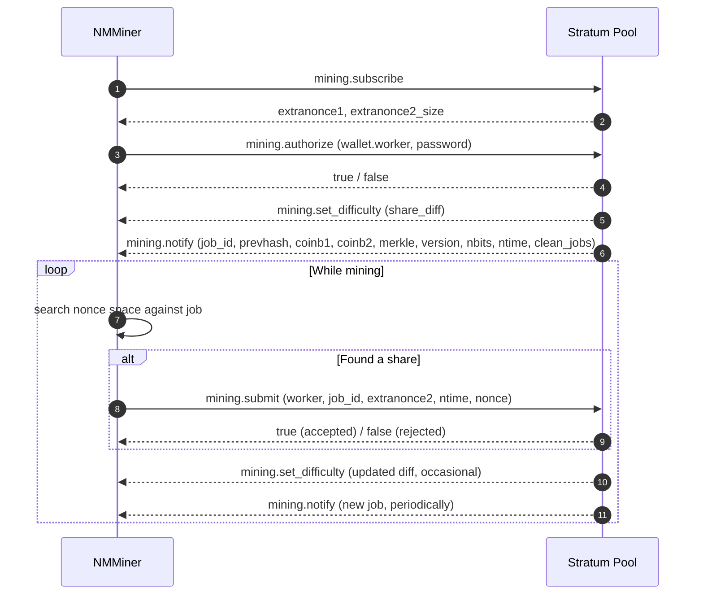

# Stratum Protocol

**Stratum v1**은 Bitcoin 마이닝 풀이 마이너와 통신하는 데 사용하는 사실상의 프로토콜입니다. NMMiner는 Stratum v1 클라이언트입니다.

> 이 페이지는 모든 풀이 이해하는 **공개적이고 잘 알려진** Stratum 메시지만 문서화합니다. 풀별 확장 및 내부 구현 세부 사항은 범위를 벗어납니다.

## 연결

- **전송**: TCP, 또는 SSL 풀의 경우 TLS로 래핑된 TCP.
- **주소 체계**:
  - `stratum+tcp://host:port` — 일반 TCP.
  - `stratum+ssl://host:port` — TLS.
- **워커 신원**: 지갑 주소 뒤에 선택적으로 `.workerName`을 붙임, 예: `bc1q....workerName`.

마이너는 전체 세션 동안 소켓을 열린 상태로 유지합니다. 풀이 연결을 끊으면 NMMiner가 자동으로 재연결합니다.

## 메시지 흐름

## 각 메시지의 의미

| 메시지                   | 쉬운 의미                                                       |
| ------------------------- | ------------------------------------------------------------------- |
| `mining.subscribe`        | "안녕하세요, 작업이 필요합니다."                                                  |
| `mining.authorize`        | "저는 이 지갑입니다."                                                 |
| `mining.set_difficulty`   | 풀이 셰어의 쉬움/어려움을 설정합니다. NMMiner의 diff는 **아주 작습니다**. |
| `mining.notify`           | "여기 작업할 새 블록 템플릿이 있습니다." 이전 작업은 폐기됩니다.   |
| `mining.submit`           | "여기 diff를 충족하는 해시가 있습니다."                               |

마이너 측 프로토콜은 이것이 전부입니다.

## 화면 / NM Monitor에서 NMMiner가 표시하는 것

| 필드            | 출처                                              |
| ---------------- | ------------------------------------------------------- |
| **Pool**         | 구성된 URL(호스트 및 포트).                     |
| **Diff**         | 최신 `mining.set_difficulty`.                         |
| **Accepted**     | `mining.submit`에 대한 `true` 응답 수.             |
| **Rejected**     | `mining.submit`에 대한 `false` 응답 수.            |
| **Session Best** | 이번 부팅에서 생성된 최고 난이도 셰어.        |
| **Ever Best**    | 모든 부팅을 통틀어 생성된 최고 난이도 셰어. |
| **Hashrate**     | 초당 해시의 내부 이동 평균.           |

참고: [풀 목록](../reference/pool-list.md) — 알려진 호환 엔드포인트.
