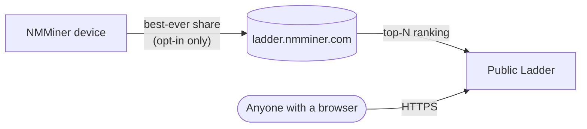

# Ladder — 글로벌 리더보드

**Ladder**는 NMMiner의 글로벌 리더보드입니다. 참여 마이너를 **역대 생성한 최고 셰어 난이도**로 순위를 매깁니다 — 해시레이트도, 셰어 수도 아닌, 당신의 역대 최고 기록입니다. 한 번의 행운의 순간이 $5짜리 ESP32를 ASIC 창고 위에 올릴 수 있습니다.

🌐 **공개 래더**: [https://ladder.nmminer.com/](https://ladder.nmminer.com/)

---

## 작동 방식

**옵트인한** 각 마이너는 역대 최고 셰어 난이도를 래더 백엔드에 주기적으로 보고합니다. 백엔드는 항목을 집계하고 [ladder.nmminer.com](https://ladder.nmminer.com/)에서 상위권을 공개합니다.

## 기기 내 래더 페이지

디스플레이가 있는 모든 NMMiner에는 리더보드를 미러링하는 선택적 **Ladder** 페이지가 있습니다 — 글로벌 Top-10을 마이너에서 바로 볼 수 있습니다. 아래의 옵트인과 함께 활성화하세요.

:::tip 화면 없는 보드(OLED 없음 / 디스플레이 없음 변형)
디스플레이가 없는 보드도 래더에 참여할 수 있습니다. [NM Monitor](./nm-monitor.md) → **Preferences**를 열고 **Ladder** 스위치를 켜세요. 볼 수 있는 기기 페이지가 없어도 마이너는 정상적으로 보고합니다.
:::

## 옵트인(기본적으로 꺼짐)

래더는 **옵트인**입니다. 출고 시 NMMiner는 아무것도 보고하지 않습니다. 참여하려면:

1. [NM Monitor](./nm-monitor.md) → **Preferences**를 엽니다.
2. **Ladder**를 켭니다.
3. 저장합니다. 기기의 래더 페이지가 활성화되고(화면이 있는 보드), 마이너가 보고를 시작합니다.

HTTP API를 통해서도 설정을 변경할 수 있습니다 — [`POST /api/setting/preference`](../api/settings-preference.md)(`LadderEnable: true`)를 참조하세요.

## 개인정보 보호

NMMiner는 참여자의 개인정보 보호를 진지하게 여깁니다:

- **개인 정보 없음** — 마이닝하는 지갑 주소만 보고되며, 공개되는 것은 그 주소의 **앞 4자 + 뒤 4자**뿐입니다(`bc1q…ab12`).
- **IP 없음, 호스트명 없음** — 당신이나 당신의 네트워크를 식별할 수 있는 것은 없습니다.
- **기본적으로 꺼짐** — 기능을 의식적으로 활성화해야 합니다.

## 참여하는 이유

- 🏅 **자랑할 권리** — 당신의 작은 ESP32가 세상과 비교해 얼마나 운이 좋았는지 확인하세요.
- 🤝 **커뮤니티** — 래더는 ESP32 BTC 애호가들의 사실상의 모임 장소입니다.
- ✨ **스릴** — 고난이도 셰어를 내는 것은 드뭅니다. 래더는 그 순간이 축하되는 곳입니다.

---

> 현재 순위를 보려면 [https://ladder.nmminer.com/](https://ladder.nmminer.com/)을 방문하세요.
