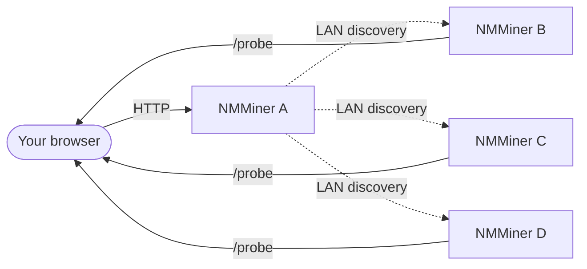

# Swarm Menu

[NM Monitor](./nm-monitor.md)의 **Swarm** 메뉴를 사용하면 **설치 없이** 단일 브라우저 페이지에서 **동일 LAN의 모든 NMMiner**를 보고 관리할 수 있습니다.

단일 /24 서브넷은 Swarm을 통해 검색 가능한 최대 **255대**의 기기를 호스팅할 수 있습니다 — 진지한 홈 / 랩 배포에 충분합니다.

## 작동 방식 (사용자 관점)

1. **아무** 마이너 하나(또는 LAN에 접근할 수 있는 모든 기기)에서 NM Monitor를 엽니다.
2. Swarm 메뉴가 빠른 LAN 스윕을 수행합니다.
3. 접근 가능한 모든 NMMiner가 행으로 표시됩니다.
4. NM Monitor가 해시레이트를 합산하고, 풀을 나열하며, 각각에 ping을 보낼 수 있게 합니다.

브라우저가 집계를 수행합니다 — 중앙 서버 없음, 클라우드 없음, 계정 없음.

## Swarm 테이블 표시 내용

| 열          | 의미                                                                |
| --------------- | ---------------------------------------------------------------------- |
| **Hostname**    | 마이너의 호스트명(Network 페이지에서 설정).               |
| **IP**          | 마이너의 LAN IP.                                                    |
| **Version**     | 마이너가 보고하는 펌웨어 버전.                                |
| **Hashrate**    | 현재 해시레이트(H/s).                                               |
| **Session Best**| 마지막 부팅 이후 최고 셰어 난이도.                     |
| **Ever Best**   | 모든 세션을 통틀어 최고 셰어 난이도.                             |
| **Uptime**      | 부팅 이후 초.                                                    |
| **Find**        | 마이너의 화면 + LED를 깜빡여 물리적으로 찾을 수 있게 하는 버튼. |

푸터 행은 군집 전체의 해시레이트를 합산하여 LAN 총 해시레이트를 한눈에 볼 수 있게 합니다. 스캔이 진행되는 동안 NM Monitor는 **진행률 표시줄**도 표시합니다(v2.0.03에서 추가).

## 일반적인 작업

### 특정 마이너를 물리적으로 찾기

1. Swarm을 엽니다.
2. 대상 행의 **Find** 버튼을 클릭합니다.
3. 선택한 마이너가 몇 초 동안 화면과 LED를 깜빡입니다 — 걸어가서 집으세요.

이것은 단일 HTTP 호출입니다([`POST /api/swarm/find`](../api/swarm-find.md)) — 자체 스크립트에서도 트리거할 수 있습니다.

### 마이너를 한눈에 비교

테이블을 **Hashrate**, **Session Best**, **Uptime**으로 정렬하여 어떤 보드가 가장 잘 작동하는지 확인하세요.

### LAN 재스캔

Swarm 메뉴는 열 때 자동으로 새로고침됩니다. 즉시 재스캔을 강제하려면 메뉴를 떠났다가 돌아오거나 페이지를 새로고침하세요.

:::tip
자체 대시보드를 만들고 싶으신가요? Swarm 테이블의 각 열은 공개 HTTP 엔드포인트에 직접 매핑됩니다. [API Reference › Discovery](../api/discovery.md)를 참조하세요.
:::
