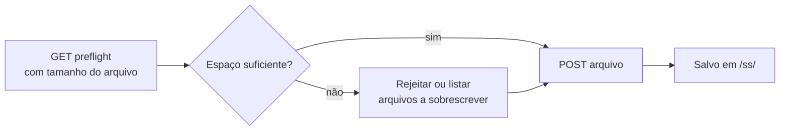

# Envio de Protetor de Tela

Envie uma imagem personalizada de protetor de tela. O navegador primeiro converte um arquivo PNG / JPG / imagem para o formato `.ss` do dispositivo; esta API recebe esse arquivo pré-convertido.

> A maioria dos usuários deve usar a página **Protetor de Tela** no [NM Monitor](../user-guide/nm-monitor.md) — ela realiza a conversão automaticamente. Esta página é para integradores que desejam enviar seus próprios ativos de forma programática.

---

## Fluxo em duas etapas



---

## `GET /api/update/screensaver/preflight`

Pergunta ao dispositivo se um arquivo de `size` bytes pode ser armazenado. O dispositivo decide se precisa liberar espaço primeiro (sobrescrevendo o protetor de tela mais antigo).

### Parâmetros de consulta

| Nome   | Obrigatório | Significado                                               |
| ------ | -------- | ----------------------------------------------------- |
| `size` | sim      | Tamanho em bytes do arquivo `.ss` que você pretende enviar. |

### Resposta — o arquivo cabe

```json
{
  "fileSize":       65536,
  "fsFree":         262144,
  "maxUploadable":  327680,
  "action":         "new",
  "overwriteCount": 0,
  "overwriteFiles": [],
  "existingCount":  2,
  "spaceAfter":     196608
}
```

### Resposta — precisa sobrescrever

```json
{
  "fileSize":       180000,
  "fsFree":         60000,
  "maxUploadable":  400000,
  "action":         "overwrite",
  "overwriteCount": 2,
  "overwriteFiles": [
    {"name": "saver_320_240_001.ss", "size": 65536},
    {"name": "saver_320_240_002.ss", "size": 72104}
  ],
  "existingCount":  4,
  "spaceAfter":     17640
}
```

### Resposta — grande demais

```json
{
  "fileSize":       1500000,
  "fsFree":         60000,
  "maxUploadable":  400000,
  "action":         "reject",
  "overwriteCount": 0,
  "overwriteFiles": [],
  "existingCount":  4,
  "spaceAfter":     0
}
```

| Campo              | Tipo      | Significado                                                        |
| ------------------ | --------- | -------------------------------------------------------------- |
| `fileSize`         | integer   | Eco do tamanho de upload solicitado.                             |
| `fsFree`           | integer   | Bytes livres atuais no FS do dispositivo.                        |
| `maxUploadable`    | integer   | Bytes livres **mais** todos os bytes de protetores existentes — o limite superior absoluto. |
| `action`           | string    | `"new"`, `"overwrite"` ou `"reject"`.                         |
| `overwriteCount`   | integer   | Quantos protetores existentes serão excluídos para liberar espaço.    |
| `overwriteFiles`   | object[]  | A lista de arquivos prestes a serem removidos (`name` + `size`).        |
| `existingCount`    | integer   | Arquivos de protetor existentes que correspondem ao tamanho de tela atual.    |
| `spaceAfter`       | integer   | Bytes livres previstos após o upload chegar.                     |

---

## `POST /api/update/screensaver`

Envia o arquivo `.ss` real como `multipart/form-data`.

### Requisição

- Tipo de conteúdo: `multipart/form-data`
- Extensão do arquivo: **deve terminar em `.ss`**.
- Tamanho máximo: **200 KB**.
- Primeiros 2 bytes do arquivo: magic `0x4E 0x53`.

### Resposta — sucesso

```json
{
  "status": "ok",
  "path":   "/ss/saver_320_240_003.ss"
}
```

### Resposta — falha

| Status | Corpo                              | Causa                                 |
| ------ | --------------------------------- | ------------------------------------- |
| 400    | `Only .ss files are accepted.`    | Extensão de arquivo incorreta.                 |
| 400    | `Invalid .ss file header.`        | Os bytes magic não correspondem.             |
| 413    | `File too large (max 200 KB).`    | O corpo excedeu 200 KB.                 |
| 500    | `Failed to open file for writing.`| Erro no sistema de arquivos.                    |
| 500    | `Write error.`                    | Erro no sistema de arquivos durante a gravação.       |

### Exemplo

```bash
SIZE=$(stat -c%s saver_320_240_003.ss)
curl "http://192.168.1.42/api/update/screensaver/preflight?size=$SIZE"
# inspecione "action"; se for "reject", aborte
curl -X POST -F "file=@saver_320_240_003.ss" \
     http://192.168.1.42/api/update/screensaver
```

:::warning
Enviar um protetor de tela **pausa brevemente a mineração** enquanto o sistema de arquivos é liberado. A taxa de hash volta ao normal em ~1 segundo.
:::

## Fluxo em duas etapas
