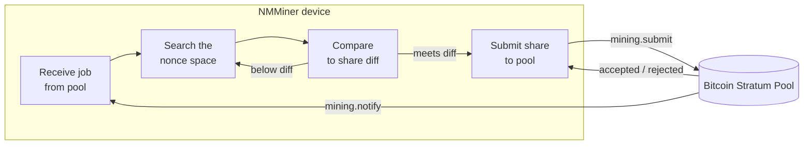

# NMMiner no Pipeline

Uma visão de caixa preta do que acontece no dispositivo entre "WiFi ativo" e "share aceita".

## Visão geral de ponta a ponta

## O que você, o operador, controla

| Controle                         | Efeito                                                          |
| ---------------------------- | --------------------------------------------------------------- |
| **URL da pool**                 | De onde vêm os trabalhos e para onde vão as shares.                       |
| **Carteira**                   | Onde os pagamentos da pool chegam.                                        |
| **Taxa de atualização da UI**          | Taxa maior → tela mais fluida, mas taxa de hash ligeiramente menor. Taxa menor → taxa de hash máxima. |
| **Modo do protetor de tela**        | `Black` remove o custo de redesenho da tela → taxa de hash de pico.            |
| **Habilitar LED**               | Apenas cosmético.                                                  |
| **Qualidade do WiFi**             | Um AP instável causa falhas no envio de shares; as rejeições aumentam.          |

## O que o NMMiner mostra enquanto trabalha

- **Página Carregando** — inicialização, handshake WiFi, chegada do primeiro trabalho.
- **Página Minerador** — taxa de hash ao vivo, contadores de shares, diff da pool, URL da pool, tempo de atividade.
- **Páginas Relógio / Preço / Clima** — páginas de informação somente leitura, não afetam a mineração.
- **Rodapé ciente do Swarm** (na página Minerador) — quando o recurso [Swarm](../user-guide/swarm.md) está ativo, o minerador também rastreia a taxa de hash total da LAN.

## O que o NMMiner **não** expõe

O NMMiner é um firmware de código fechado. Esta wiki documenta as **entradas**, as **saídas** e o **comportamento observável** do dispositivo. Ela não documenta:

- Como o loop interno SHA-256d é implementado (este é o trabalho central de otimização do NMMiner).
- O layout de tarefas no chip, o layout de memória ou a pilha de drivers.
- O layout de armazenamento interno, buffers de protocolo ou a estratégia do analisador Stratum.

Se você quiser integrar com o dispositivo, faça isso através da [HTTP API](../api/overview.md) documentada — esse é o contrato estável e suportado.
