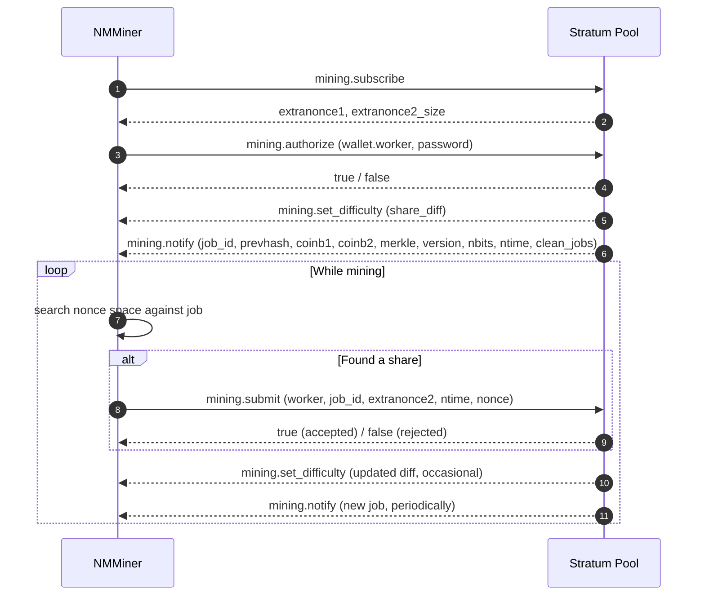

# Protocolo Stratum

O **Stratum v1** é o protocolo de fato que as pools de mineração de Bitcoin usam para se comunicar com os mineradores. O NMMiner é um cliente Stratum v1.

> Esta página documenta apenas as mensagens Stratum **públicas e bem conhecidas** que toda pool entende. Extensões específicas de pool e detalhes internos de implementação estão fora do escopo.

## Conexão

- **Transporte**: TCP, ou TCP encapsulado em TLS para pools SSL.
- **Esquema de endereço**:
  - `stratum+tcp://host:port` — TCP simples.
  - `stratum+ssl://host:port` — TLS.
- **Identidade do worker**: o endereço da carteira opcionalmente seguido de `.nomeDoWorker`, ex.: `bc1q....nomeDoWorker`.

O minerador mantém o socket aberto durante toda a sessão. Se a pool o encerrar, o NMMiner se reconecta automaticamente.

## Fluxo de mensagens

## O que cada mensagem significa para você

| Mensagem                   | Significado simples                                                       |
| ------------------------- | ------------------------------------------------------------------- |
| `mining.subscribe`        | "Olá, quero trabalho."                                                  |
| `mining.authorize`        | "Eu sou esta carteira."                                                 |
| `mining.set_difficulty`   | A pool define o quão fácil / difícil uma share deve ser. A diff do NMMiner é **minúscula**. |
| `mining.notify`           | "Aqui está um novo modelo de bloco para trabalhar." Trabalhos antigos ficam obsoletos.   |
| `mining.submit`           | "Aqui está um hash que atende a diff."                               |

É tudo o que há no protocolo do lado do minerador.

## O que o NMMiner mostra na tela / no NM Monitor

| Campo            | Vem de                                              |
| ---------------- | ------------------------------------------------------- |
| **Pool**         | A URL configurada (host e porta).                     |
| **Diff**         | Último `mining.set_difficulty`.                         |
| **Accepted**     | Contagem de respostas `true` para `mining.submit`.             |
| **Rejected**     | Contagem de respostas `false` para `mining.submit`.            |
| **Session Best** | A share de maior dificuldade produzida nesta inicialização.        |
| **Ever Best**    | A share de maior dificuldade produzida em todas as inicializações. |
| **Hashrate**     | Média móvel interna de hashes por segundo.           |

Veja também: [Lista de Pools](../reference/pool-list.md) para endpoints compatíveis conhecidos.

O minerador mantém o socket aberto durante toda a sessão. Se a pool derrubar a conexão, o NMMiner se reconecta automaticamente.

## Fluxo de mensagens
