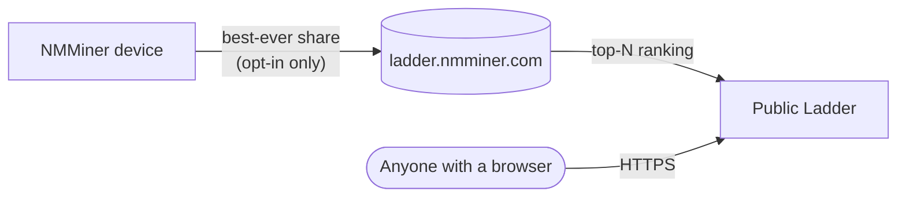

# Ladder — Ranking Global

O **Ladder** é o ranking global do NMMiner. Ele classifica os mineradores participantes pela **maior dificuldade de share que já produziram** — seu melhor de todos os tempos, não sua taxa de hash, não sua contagem de shares. Um único momento de sorte pode colocar um ESP32 de R$30 acima de um galpão de ASICs.

🌐 **Ladder público**: [https://ladder.nmminer.com/](https://ladder.nmminer.com/)

---

## Como funciona

Cada minerador que **opta por participar** relata periodicamente sua melhor dificuldade de share de todos os tempos ao backend do Ladder. O backend agrega as entradas e expõe os melhores desempenhos em [ladder.nmminer.com](https://ladder.nmminer.com/).

## Página Ladder no dispositivo

Todo NMMiner com display tem uma página **Ladder** opcional que espelha o ranking — veja o top-10 global diretamente no seu minerador. Ative-a junto com o opt-in abaixo.

:::tip Placas sem tela (variantes sem OLED / sem display)
Placas sem display ainda podem participar do Ladder. Basta abrir o [NM Monitor](./nm-monitor.md) → **Preferences** e ativar o interruptor **Ladder**. Seu minerador relatará normalmente, mesmo que não haja uma página no dispositivo para visualizar.
:::

## Opt-in (desligado por padrão)

O Ladder é **opt-in**. De fábrica o NMMiner não relata nada. Para participar:

1. Abra o [NM Monitor](./nm-monitor.md) → **Preferences**.
2. Ative **Ladder**.
3. Salve. A página Ladder do dispositivo se torna ativa (em placas com tela) e seu minerador começa a relatar.

Você também pode alterar a configuração através da HTTP API — veja [`POST /api/setting/preference`](../api/settings-preference.md) (`LadderEnable: true`).

## Privacidade

O NMMiner leva a privacidade dos participantes a sério:

- **Sem informações pessoais** — apenas o endereço da carteira para o qual você minera é relatado, e apenas os **primeiros 4 + últimos 4 caracteres** desse endereço são exibidos publicamente (`bc1q…ab12`).
- **Sem IP, sem hostname** — nada que possa identificá-lo ou à sua rede.
- **Desligado por padrão** — você precisa habilitar o recurso conscientemente.

## Por que participar?

- 🏅 **Direito de se gabar** — veja o quão sortudo seu pequeno ESP32 foi em comparação com o mundo.
- 🤝 **Comunidade** — o Ladder é o ponto de encontro de fato para entusiastas de BTC com ESP32.
- ✨ **A emoção** — acertar uma share de alta dificuldade é raro; o Ladder é onde esses momentos são celebrados.

---

> Visite [https://ladder.nmminer.com/](https://ladder.nmminer.com/) para ver a classificação atual.

## Como funciona
