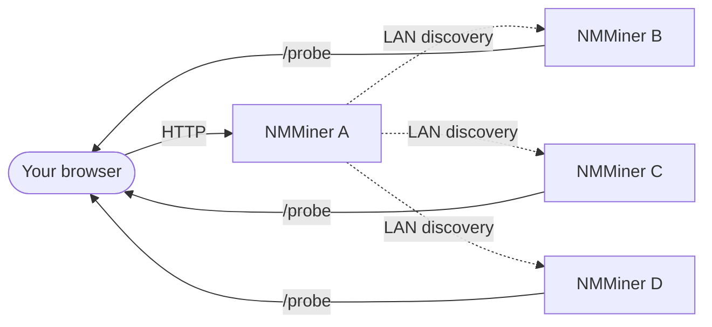

# Menu Swarm

O menu **Swarm** no [NM Monitor](./nm-monitor.md) permite que você veja e gerencie **todos os NMMiner na mesma rede local** a partir de uma única página do navegador, com **zero instalação**.

Uma única sub-rede /24 pode hospedar até **255 dispositivos** detectáveis através do Swarm — facilmente suficiente para uma implantação doméstica ou de laboratório séria.

## Como funciona (visão do usuário)

1. Você abre o NM Monitor em **qualquer** minerador (ou qualquer dispositivo que possa acessar a rede local).
2. O menu Swarm realiza uma varredura rápida da rede local.
3. Cada NMMiner acessível aparece como uma linha.
4. O NM Monitor soma suas taxas de hash, lista suas pools e permite que você faça ping em cada uma.

O navegador faz a agregação — sem servidor central, sem nuvem, sem conta.

## O que a tabela Swarm mostra

| Coluna          | Significado                                                                |
| --------------- | ---------------------------------------------------------------------- |
| **Hostname**    | O hostname do minerador (você define na página Network).               |
| **IP**          | O IP LAN do minerador.                                                    |
| **Version**     | Versão do firmware relatada pelo minerador.                                |
| **Hashrate**    | Taxa de hash atual em H/s.                                               |
| **Session Best**| Melhor dificuldade de share desde a última inicialização do minerador.                     |
| **Ever Best**   | Melhor dificuldade de share em todas as sessões.                             |
| **Uptime**      | Segundos desde a inicialização.                                                    |
| **Find**        | Um botão que pisca a tela + LED do minerador para que você possa localizá-lo fisicamente. |

Uma linha de rodapé soma a taxa de hash de todo o enxame para que você veja sua taxa de hash total da LAN de relance. Enquanto uma varredura está em andamento, o NM Monitor também mostra uma **barra de progresso** (adicionada na v2.0.03).

## Tarefas comuns

### Encontrar um minerador específico fisicamente

1. Abra o Swarm.
2. Clique no botão **Find** na linha de destino.
3. O minerador selecionado pisca sua tela e LED por alguns segundos — vá até ele e pegue-o.

Isso é apenas uma chamada HTTP ([`POST /api/swarm/find`](../api/swarm-find.md)) — você também pode acioná-la de seus próprios scripts.

### Comparar mineradores de relance

Ordene a tabela por **Hashrate**, **Session Best** ou **Uptime** para ver qual placa está com melhor desempenho.

### Re-varrer a LAN

O menu Swarm se atualiza sozinho quando você o abre. Para forçar uma nova varredura imediata, saia do menu e volte, ou recarregue a página.

:::tip
Quer montar seu próprio dashboard? Cada coluna da tabela Swarm mapeia diretamente para um endpoint HTTP público. Veja [API Reference › Discovery](../api/discovery.md).
:::
4. O NM Monitor soma suas taxas de hash, lista suas pools e permite fazer ping em cada um.
